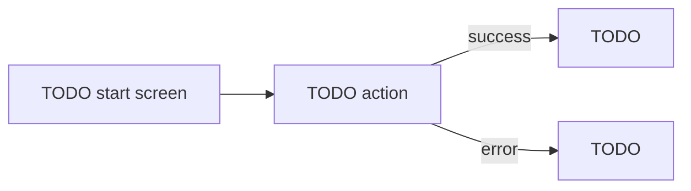

# 03 · App flow

**Status:** Not started · **Owner:** TODO · **Approved by:** TODO · **Date:**
TODO

What happens when someone clicks: every screen, where each action leads, and
where people land when something goes wrong.

## Screens

"Who can see it" uses the roles from [01](01-product-requirements.md). Hiding a
screen in the UI isn't protection; the access rules in
[05](05-database-schema.md) enforce it on the server.

| Screen | URL  | Who can see it | What it's for |
| ------ | ---- | -------------- | ------------- |
| TODO   | `/`  | Everyone       | TODO          |
| TODO   | TODO | TODO           | TODO          |

## Flows

One block per journey, e.g. sign up, book an appointment, pay an invoice.

### Flow 1 · TODO name

- **Who:** TODO: role
- **Starts at:** TODO: screen
- **Steps:**
  1. TODO
- **On success:** TODO: where they land and what they see
- **On failure:** TODO: e.g. invalid input, payment declined, network down
- **Not signed in, or not allowed:** TODO

Optional diagram (GitHub renders Mermaid):

<!-- Copy the Flow 1 block for each journey. -->

## When things go wrong

Where people land anywhere in the app. Every row needs an answer before
building starts.

| Situation                         | What the user sees | Where they can go next |
| --------------------------------- | ------------------ | ---------------------- |
| Page doesn't exist (404)          | TODO               | TODO                   |
| Not signed in                     | TODO               | TODO                   |
| Signed in but not allowed         | TODO               | TODO                   |
| Something failed (server/network) | TODO               | TODO                   |
| Nothing to show yet (empty list)  | TODO               | TODO                   |
| Still loading                     | TODO               | n/a                    |

## Emails and notifications

| Trigger | Who gets it | What it says |
| ------- | ----------- | ------------ |
| TODO    | TODO        | TODO         |
